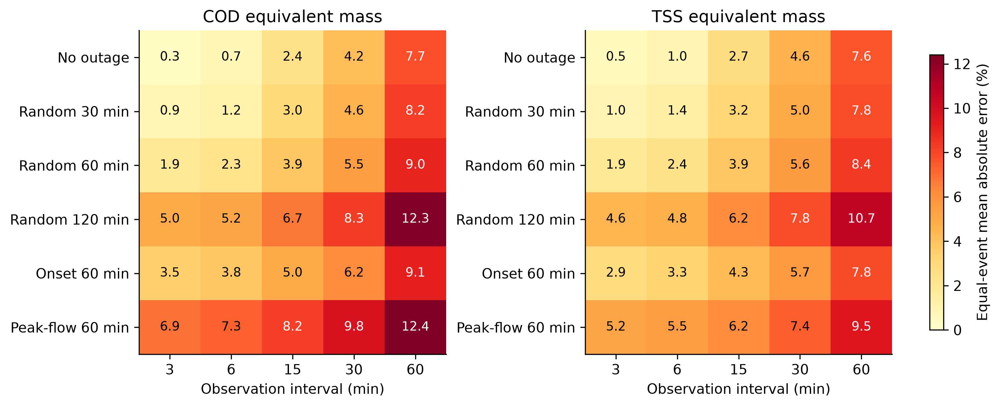

# Sampling intervals and sensor outages in COD and TSS mass reconstruction

Research supplement for the Graz-West R05 case study by Viet Nam Tran, Van Lang University. This repository is not evidence of conference acceptance or journal publication.

## Version and scope

The main branch and release v1.3.0 use the organized layout below. Run commands from the repository root. Manuscript revision 5 cites release v1.3.0. It adds the review checks described below and changes no primary result. Releases v1.1.0 and v1.2.0 remain unchanged and keep their original flat layout; use their own README when checking out those tags.

## Find what you need

| Folder | Contents |
| --- | --- |
| [scripts/](scripts/) | Data preparation, analysis, plotting and numerical tests |
| [results/tables/](results/tables/) | Fifteen key CSV tables for quick reading |
| [results/archives/](results/archives/) | Complete primary, supplementary and revision-check results |
| [results/figures/](results/figures/) | Overview figure |
| [docs/](docs/) | Audit report, revision 5 notes and repository layout notes |
| [verification/](verification/) | Checksums, execution logs and verification reports |

Generated folders `graz/`, `analysis/`, `supplemental_analysis/` and `revision_analysis/` are local working outputs and are ignored by Git. No raw archive is stored in the public repository.

The primary analysis contains 66 rainfall-response windows and 228096 reconstructions. Flow stays available while concentration observations are reduced or masked. Mean absolute errors at 15-minute sampling with linear reconstruction are 2.45%/2.73% (COD/TSS) without outages, 3.86%/3.90% for random 60-minute gaps, and 8.19%/6.20% near peak flow. All means give equal weight to events. The matching event medians are 1.60%/1.84%, 2.59%/2.73% and 4.08%/3.88%; means are pulled up by a few windows (see below).

## Reference quality and the flagged window

The reference was screened for data coverage and flow range; it is not independently validated pollutant mass. In event 20110604T1250, local COD was 0.1316 mg/L and global TSS was 10.7 mg/L at the flow peak. No observation-level quality flags, dated maintenance record or same-day laboratory sample was found in the supplied archive. A probe artefact is possible, but the cause cannot be established from these records. No unsupported universal lower concentration threshold is used.

The 66-event analysis is retained for transparency. Excluding this window gives no-gap errors of 2.33%/2.50%, random-gap errors of 3.73%/3.66%, and peak-gap errors of 7.53%/6.19%. Paired peak penalties become 5.09/3.64 percentage points. Full Table 2, Table 3, penalty and contrast sensitivities are in results/archives/supplemental_results.zip. These checks do not establish that the other windows are free of sensor artefacts.

Both pollutant equivalents come from the same spectrometer and are not independent sensor replications. A separate nearest-original-observation test gives 3-, 6-, and 15-minute no-gap errors of 0.35/0.51%, 0.85/1.12%, and 2.64/2.99%. It selects the nearest native point within one minute, removes duplicate selections and drops scheduled points with no eligible observation. The reference itself remains interpolated, so this is not independent accuracy validation.

## Revision 5 checks (release v1.3.0)

scripts/revision_checks.py adds five analyses. Outputs are in results/archives/revision_results.zip (folder revision_analysis/), with four summary tables in results/tables/. All primary tables are unchanged.

- **Laboratory samples.** The archive holds 53 grab samples from nine days (September 2008 to June 2009). 52 have an original sensor reading within three minutes; only four fall inside retained windows. Sensor minus laboratory: local COD median -10.2%, median absolute difference 21.2%, mean absolute 25.3%, Pearson r 0.92; global TSS median +22.2%, median absolute 28.0%, mean absolute 73.8%, r 0.76. The local COD calibration was derived from laboratory analyses at this station, so its agreement is not out-of-sample. These differences are several times larger than the 2-8% temporal reconstruction errors, which therefore describe sampling and gap effects relative to the sensor record, not accuracy against laboratory mass.
- **Low-concentration screen.** Eight of 66 windows contain at least one original local-COD value below 20 mg/L (0.28% of the whole record lies below this level). Removing them (58 windows) gives no-gap errors of 2.26%/2.36%, random-gap 3.66%/3.52% and peak-gap 7.18%/6.04% (COD/TSS); paired peak penalties are 4.79 (95% CI 2.93-7.07) and 3.61 (2.39-5.01) points. Thresholds of 10 and 30 mg/L remove two and nine windows and give peak-gap errors of 7.58%/6.20% and 6.91%/5.73%. The screen is post hoc and does not classify low values as sensor failure; some may be real dilution.
- **Influence of large errors.** For peak gaps, the five largest event errors supply 36.5% (COD) and 27.7% (TSS) of the summed error. Without them the means are 5.62% and 4.85%; 10% trimmed means are 5.81% and 5.13%.
- **Exposure-adjusted contrast.** A within-event regression of error on the reference mass share inside the gap gives slopes of 0.30 (95% CI 0.12-0.53) and 0.17 (0.04-0.28) points per percent of mass. At equal mass share the remaining peak-minus-uniform difference is 0.43 points for COD (-1.70 to 2.68) and -0.44 for TSS (-1.61 to 0.95), against unadjusted 4.33 and 2.30. In this linear description the peak-gap excess is accounted for by the larger mass share inside the gap; no separate timing effect is detected.
- **Flow resolution.** A median of 22% of consecutive analogue flow readings inside a window repeat the previous value (range 11-31%), so the effective flow resolution is coarser than the one-minute time stamps.

The 2300 L/s saturation sensitivity removes exactly one window, 20110604T1250. It is therefore the same 65-window sample as the flagged-window exclusion, and the two must be read as one test.

## Data source and licences

Original observations: Pichler, Hofer, Gamerith and Gruber, Zenodo version 0.1, https://doi.org/10.5281/zenodo.15783832. Dataset description: https://doi.org/10.3390/data11030045. Raw archive MD5: `307525c96633e977e144357e014acfc8`. The original data, including the small source-record extract in the supplement, retain CC BY 4.0 attribution requirements. Analysis code is MIT licensed; see LICENSE. AI tools assisted code development, analysis and writing.

## Reproduce from a clean clone

Use Python 3.12. The .gitattributes file preserves exact release bytes on Windows and other platforms so Git line-ending conversion cannot invalidate SHA256 checks. Run in the repository root:

```text
python -m venv .venv
# Windows: .venv\Scripts\activate
# Linux/macOS: source .venv/bin/activate
python -m pip install -r requirements.txt
python scripts/verify_outputs.py --rerun
```

The verifier runs scripts/prepare_data.py, scripts/test_analysis.py, scripts/analyse_graz.py, scripts/make_figures.py, scripts/additional_analysis.py, scripts/native_knot_analysis.py, scripts/uncertainty_analysis.py, scripts/make_supplemental_figures.py, scripts/qc_sensitivity.py and scripts/revision_checks.py. It then compares regenerated numeric tables with the archived release (rtol=atol=1e-10), checks release-file SHA256 hashes, and writes verification/verification_report.json. Reproduction is numerical consistency, not independent validation of field measurements.

scripts/prepare_data.py downloads the original Zenodo archive. If a download is blocked, obtain the unchanged archive from the cited Zenodo record and place it at `graz/data-set.zip`; the script verifies its MD5 before extraction. A run using this already downloaded, checksum-verified archive is recorded in verification/reproduction_log.txt. The source download endpoint is not guaranteed to be continuously available.

For separate steps, use `python scripts/run_pipeline.py`, followed by `python scripts/verify_outputs.py`. Analysis outputs go to analysis/, supplemental_analysis/ and revision_analysis/, never to the script directory. Importing a module does not run its analysis.

## Read saved results without running the analysis

```text
python -m zipfile -e results/archives/analysis_results.zip .
python -m zipfile -e results/archives/supplemental_results.zip .
python -m zipfile -e results/archives/revision_results.zip .
```

The first archive contains analysis/ (primary data tables, replicate metrics, sensitivity tables and Figures 1–4). The second contains supplemental_analysis/ (additional analyses, Figure 5, exploratory correlation figure, native-sample and source-QC/exclusion outputs). The third contains revision_analysis/ (laboratory comparison, low-concentration screen, influence, exposure-adjusted contrast and flow-resolution tables). Key tables are supplied in results/tables/. verification/SHA256_manifest.json uses paths relative to the repository root; the manifest, verification report and reproduction log are excluded from its own list to avoid circular hashes and allow local verification to regenerate the report.



## Interpretation and reproducibility notes

- The one-minute reference permits interpolation across at most six minutes. Original-point fractions have the same rounded median/range for COD and TSS (0.590; 0.323–0.896), although five windows differ. All source Q/COD/TSS timestamps are aligned to whole minutes; at_minutes nevertheless retains sub-minute timing for other inputs.
- The concentration shift test rebuilds its reference from shifted concentrations. It measures sampling-error stability, not clock-offset mass bias against an unchanged reference.
- Spearman results now describe correlation time tau versus error at each interval. Interval/tau ranks are the reverse of tau ranks within a fixed interval; the five intervals are not independent tests. Tau is computed on an interpolated series and searched only up to one quarter of each window.
- Primary means and all 228096 primary reconstruction rows are unchanged. Some bootstrap CI endpoints change because statistical streams are separated from plotting jitter and group iteration order. Correlation signs reverse with the stated predictor. See verification/revision_changes.json.
- Peak/onset gaps retain their full 60-minute duration; peak gaps are shifted within bounds. A flow-weighted gap is not a mass-matched causal timing comparison. Native-knot quadrature changes integration support, not the virtual sampling source.
- At two decimals, TSS random-120 and peak-60 means both display 6.20%, from 6.2023879494 and 6.2019061963%. The TSS peak paired penalty (3.3896575463 points) and previous-value no-gap error (3.3938250241%) both display 3.39 by coincidence. Paired penalties use matching phase draws.
- No window exceeds 90% native points for both pollutants. The empty high_native_subset.csv is a documented negative diagnostic, not a failed or omitted calculation.
- The primary and supplementary archives were produced in the environment recorded in results/provenance.json. Release v1.3.0 regenerated all 59 earlier tables within 1e-10 and produced the revision tables under Python 3.13.18, NumPy 2.5.3, pandas 3.0.5 and matplotlib 3.11.2 (see revision_analysis/revision_report.json). requirements.txt lists the environment of the v1.2.0 audit; the results did not depend on these version differences.
- Results at 3- and 6-minute intervals use a reference that is itself interpolated from 1- or 3-minute observations and should be read as a numerical consistency check, not as attainable field accuracy.
- Pichler and Muschalla (Water 2026, 18(20), 2486; https://doi.org/10.3390/w18202486) is an existing publication, confirmed on the publisher page on 3 November 2026.

The versioned GitHub release identifies the code and results. It has no Zenodo DOI. The unresolved physical cause of the flagged event should be reviewed with the supervisor or source-data authors before treating the manuscript as ready for submission.

## Repository audit — 3 November 2026

This audit refers to the earlier release v1.2.0 at ae82bf5113037ad47aa2b575719f42fa17d8cbbf; manuscript revision 5 cites v1.3.0. A clean clone of that tag completed the full pipeline with six tests, 59 matching numeric tables and 32 matching file hashes. The source ZIP was supplied from a previously downloaded copy with its MD5 verified; this did not test live Zenodo downloading or a newly installed Python environment.

The subsequent maintenance commit removes 16 consecutive duplicate statements across three supplemental scripts. It does not change the method or archived research results. See docs/AUDIT_2026-11-03.md, verification/verification_clean_clone_v120.json and verification/clean_clone_v120.log.txt. Manuscripts should continue to cite the frozen research release.
